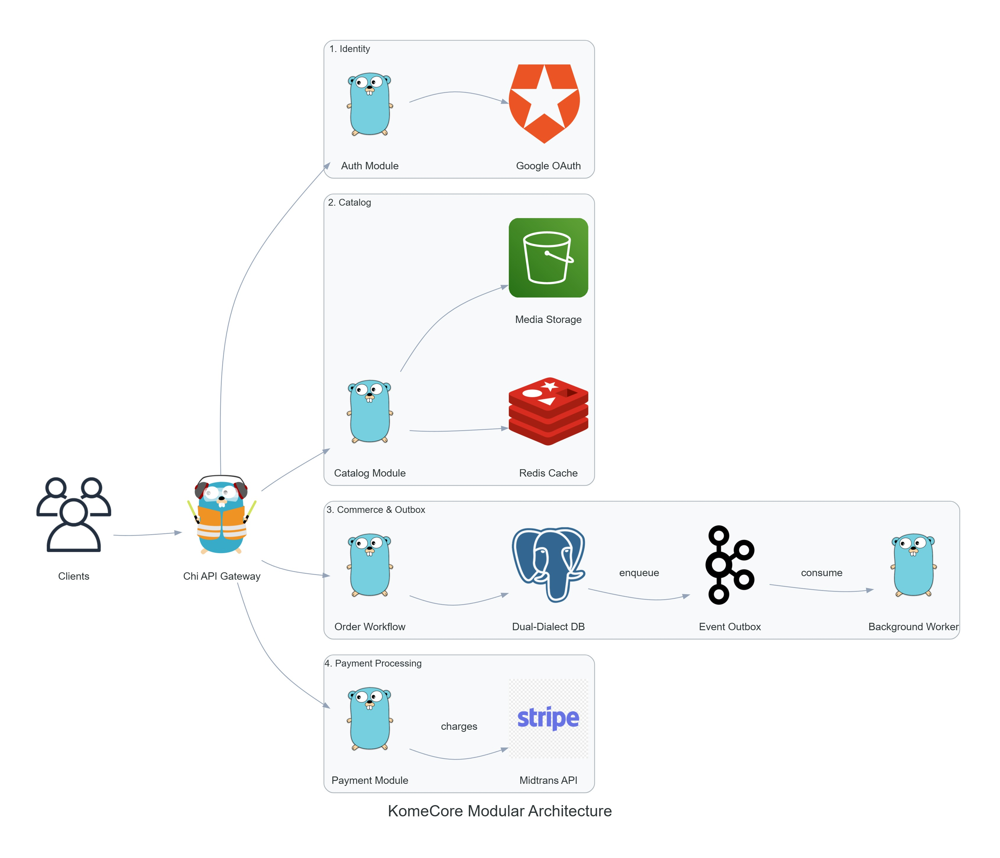

# Commerce System Design Matrix

> **Status**: `[x]` Implemented in KomeCore · `[ ]` Planned / Future Opportunity  
> **Jump**: [Write](#write) · [Read](#read) · [Consistency](#consistency) · [Async & Events](#async--events) · [Resilience](#resilience) · [Storage & Scaling](#storage--scaling) · [Observability](#observability) · [Security & Auth](#security--auth)

---

### Write

- [x] **Task-Based Mutation Workflows (Pragmatic CQRS Command Side)**  
  Segregates complex write orchestration away from standard CRUD services into dedicated workflow coordinators.  

  *In KomeCore*: Handled via [`order.CreateOrderWorkflow`](../internal/modules/order/create_order.go). Coordinates parallel pre-flight validation, gateway charges, transactional order creation across multiple shops, stock reservation, and outbox event enqueueing.

- [x] **Compensating Transactions (Saga-Lite)**  
  Automatically executes compensating actions to reverse side-effects when a distributed sequence fails midway (e.g. aborting external charges if database persistence fails).  

  *In KomeCore*: Built into [`order.CreateOrderWorkflow`](../internal/modules/order/create_order.go). If the database commit fails after authorizing a charge with Midtrans, the workflow immediately triggers `CancelTransaction` on the payment gateway to prevent orphaned charges.

- [x] **Dual-Dialect Transactor Pattern**  
  Provides a database-agnostic interface (`WithinTransaction`) to execute multi-table mutations atomically without tying domain logic to a specific SQL driver.  

  *In KomeCore*: Implemented in [`internal/infra/transactor`](../internal/infra/transactor). The domain service controls boundaries via `s.transactor.WithinTransaction()`, while repositories accept a generic `Executor` compatible with both PostgreSQL (`pgx`) and SQL Server (`go-mssqldb`).

- [x] **Distributed Idempotency Keys (24-Hour Lease & Cache)**  
  Protects write endpoints against network duplicate retries, double-clicks, and race conditions by enforcing a unique client mutation token.  

  *In KomeCore*: Implemented in [`internal/httpx/middleware/idempotency.go`](../internal/httpx/middleware/idempotency.go). Acquires a 120-second distributed Redis lock for in-flight requests and caches successful 2xx responses for 24 hours. Clears keys immediately on 4xx client errors to allow corrected retries.

- [x] **Exact Minor-Unit Financial Arithmetic**  
  Prevents floating-point rounding inaccuracies in taxes, discounts, shipping fees, and multi-shop splits by strictly using integer minor currency units.  

  *In KomeCore*: Centralized in [`pkg/money`](../pkg/money). All monetary operations, discounts, and invoice tallies operate on `int64` minor units.

- [ ] **Full Saga Orchestrator / Choreography Engine**  
  Central state machine (or event choreography) coordinating multi-stage order lifecycles across independent microservices with durable execution.  

  *Opportunity*: As KomeCore evolves from a modular monolith into decoupled services, integrate a workflow engine (such as Temporal or an outbox-driven choreography state machine).

- [ ] **Two-Phase Commit (2PC) / Distributed Transactions**  
  Atomic transaction coordination across physically heterogeneous data stores (e.g., relational DB + separate ledger database).  

  *Opportunity*: Generally avoided in modern microservices in favor of eventual consistency and Sagas, but applicable if financial ledgers move to a separate database cluster.

---

### Read

- [x] **Read-Optimized Projections / DTOs (Pragmatic CQRS Query Side)**  
  Direct database-to-DTO query projections that bypass heavy domain entities and aggregate hydration.  

  *In KomeCore*: Product and order queries use specialized query methods (e.g. `FindProductsWithInventory`, `FindOrders`, `GetProductStatsParams`) in [`internal/modules/product`](../internal/modules/product) and [`internal/modules/order`](../internal/modules/order) returning streamlined models for presentation.

- [x] **Multi-Tier Cache-Aside Pattern**  
  Caches hot catalog reads in a fast in-memory or distributed key-value store with transparent fallback when cache nodes fail.  

  *In KomeCore*: Implemented in [`internal/infra/cache`](../internal/infra/cache). Supports Redis 7+ (`go-redis/v9`) as primary cache with seamless, thread-safe in-memory map fallback (`memory.go`) when Redis is disabled or unreachable.

- [x] **Structured Filtering, Pagination & Multi-Attribute Sorting**  
  Parameter-object queries supporting cursor/offset pagination, dynamic filtering (shop, category, status), and multi-field sorting (price, view count, sales velocity, margin).  

  *In KomeCore*: Standardized in [`internal/pagination`](../internal/pagination) and implemented across module repositories (e.g., [`product/repository.go`](../internal/modules/product/repository.go)).

- [ ] **Primary / Read-Replica Splitting (Master-Slave Routing)**  
  Routes read-only queries to secondary database replicas while directing writes to the primary database to prevent catalog traffic from starving transaction pools.  

  *Opportunity*: Update [`internal/infra/db/connection.go`](../internal/infra/db/connection.go) to maintain separate read and write connection pools, injecting a read-only `Executor` into query services.

- [ ] **Dedicated Search Engine (Inverted Index / Vector Search)**  
  Full-text fuzzy search engine providing typo tolerance, stemming, synonyms, instant autocomplete, and faceted filters for deep catalogs.  

  *Opportunity*: Offload product search from SQL `LIKE` queries to **Elasticsearch**, **Meilisearch**, or **Typesense**, synchronized asynchronously via the outbox event worker.

- [ ] **CQRS Denormalized Read Views (Materialized Store)**  
  Fully flattened read models stored in a fast document store (e.g., MongoDB, DynamoDB, or Redis JSON) updated via domain events for sub-millisecond storefront rendering.  

  *Opportunity*: Introduce read-model event listeners consuming outbox events to maintain denormalized product and category views.

---

### Consistency

- [x] **Atomic Conditional Stock Deduction (Flash-Sale Guard)**  
  Modifies inventory balances using single-statement conditional SQL updates rather than separate read-then-write operations, preventing overselling without table locks.  

  *In KomeCore*: Implemented in [`internal/modules/inventory`](../internal/modules/inventory). Executes updates with `WHERE (stock - reserved_stock) >= quantity`. If inventory is exhausted, zero rows are affected and the transaction immediately aborts.

- [x] **Idempotent Webhook Deduplication (Event Ledger)**  
  Guards against duplicate HTTP webhook deliveries from third-party payment gateways using a persistent event ledger.  

  *In KomeCore*: Built into [`internal/modules/payment`](../internal/modules/payment). Webhooks log incoming event IDs using SQL `ON CONFLICT DO NOTHING`. Redundant deliveries are acknowledged with `200 OK` without triggering duplicate order state transitions.

- [x] **Deterministic Clock Injection**  
  Abstracts time generation behind an interface so time-sensitive validations (voucher expiry, flash sale windows, payment timeouts) can be deterministically tested.  

  *In KomeCore*: Standardized across all modules via [`pkg/clock`](../pkg/clock). Logic calls `appclock.Now()` rather than `time.Now()`, allowing mock time injection in unit tests.

- [ ] **Optimistic Concurrency Control (OCC / Version Stamping)**  
  Prevents lost updates when multiple staff members or shoppers simultaneously edit the same aggregate using a `version` column.  

  *Opportunity*: Add `version INT NOT NULL DEFAULT 1` to products and carts, appending `AND version = $expected` to mutation queries.

- [ ] **Distributed Mutex (Redlock) for Cart Merging**  
  Acquires a cluster-wide distributed lock when merging anonymous guest carts into authenticated customer accounts across multiple concurrent devices.  

  *Opportunity*: Extend [`internal/infra/cache`](../internal/infra/cache) to provide a Redis distributed lock primitive with TTL auto-renewal.

---

### Async & Events

- [x] **Transactional Outbox Pattern**  
  Atomically persists domain events into an `outbox_events` table inside the exact same database transaction as the business mutation, eliminating the dual-write problem.  

  *In KomeCore*: Implemented in [`internal/infra/outbox`](../internal/infra/outbox). Domain services call `outboxRecorder.Enqueue()` inside `WithinTransaction()`.

- [x] **Contention-Free Polling with `FOR UPDATE SKIP LOCKED`**  
  Enables multiple background workers to concurrently poll and claim pending outbox events without locking each other or causing database deadlocks.  

  *In KomeCore*: The outbox repository ([`internal/infra/outbox/recorder.go`](../internal/infra/outbox/recorder.go)) queries pending events using PostgreSQL `FOR UPDATE SKIP LOCKED`.

- [x] **Exponential Retry Backoff**  
  Automatically reschedules failed asynchronous tasks with increasing delays ($\Delta t = 2^{\text{retry}} \times 10\text{s}$) up to a maximum retry limit.  

  *In KomeCore*: Implemented in [`outbox.CalculateBackoff`](../internal/infra/outbox/worker.go).

- [ ] **Distributed Message Broker Integration**  
  Publishes outbox events to external message streaming backbones (Kafka, RabbitMQ, NATS, AWS SQS) for cross-service consumption.  

  *Opportunity*: Add a broker dispatcher implementing [`outbox.Dispatcher`](../internal/infra/outbox/dispatcher.go) to forward events to a message bus.

- [ ] **Dead Letter Queue (DLQ) & Admin Re-Drive**  
  Isolates permanently failed events after maximum retries into a DLQ with administrative tooling to inspect payloads and replay them.  

  *Opportunity*: Add a dedicated `dead_letter_events` table, alerting triggers, and staff API endpoints to re-queue failed messages.

- [ ] **Event Sourcing**  
  Models state as an immutable sequence of domain events rather than mutable rows, enabling time-travel debugging and complete historical audit trails.  

  *Opportunity*: Useful for financial ledger and wallet balance subsystems; can be adopted on a per-module basis.

---

### Resilience

- [x] **Sliding-Window Rate Limiting**  
  Enforces request thresholds per client IP to mitigate automated scraping, inventory denial-of-service, and credential stuffing.  

  *In KomeCore*: Implemented in [`internal/httpx/middleware/rate_limit.go`](../internal/httpx/middleware/rate_limit.go) via [`pkg/ratelimit`](../pkg/ratelimit).

- [x] **Panic Recovery & Centralized Error Masking**  
  Intercepts unhandled runtime exceptions, outputs structured diagnostic logs, and shields database error details behind RFC-compliant JSON envelopes.  

  *In KomeCore*: Implemented in [`internal/httpx/middleware/recovery.go`](../internal/httpx/middleware/recovery.go) and [`internal/apperror`](../internal/apperror).

- [x] **Graceful Shutdown Lifecycle**  
  Listens for termination signals (`SIGINT`/`SIGTERM`), halts incoming HTTP requests, drains in-flight database transactions with a timeout, and shuts down background schedulers cleanly.  

  *In KomeCore*: Implemented in [`internal/bootstrap/app.go`](../internal/bootstrap/app.go).

- [ ] **Circuit Breaker Pattern**  
  Wraps external third-party API calls (Midtrans, Supabase, courier shipping APIs) in a state machine (Closed, Open, Half-Open) to fail fast when external providers experience degradation.  

  *Opportunity*: Introduce a circuit breaker (e.g. `sony/gobreaker`) into [`internal/infra/paymentgateway`](../internal/infra/paymentgateway) and [`internal/infra/shipping`](../internal/infra/shipping).

- [ ] **Bulkhead Pattern**  
  Partitions thread pools, HTTP connection pools, and memory quotas so an outage in a non-critical feature cannot deplete resources needed for checkout.  

  *Opportunity*: Configure separate bounded worker pools for background schedulers and distinct connection pools for critical vs non-critical services.

- [ ] **Edge Caching & Dynamic CDN Tagging**  
  Uses `Surrogate-Key` or `Cache-Tag` headers on responses so CDNs (Cloudflare, Fastly) can cache public catalog responses at the edge and instantly invalidate them upon stock or price updates.  

  *Opportunity*: Add an edge cache tagging middleware to public product and shop endpoints.

---

### Storage & Scaling

- [x] **Pluggable Cloud Object Storage**  
  Abstract media storage provider enabling zero-code-change switching between cloud storage backends and local development stubs.  

  *In KomeCore*: Implemented in [`internal/infra/storage`](../internal/infra/storage) with adapters for Supabase Storage, Google Cloud Storage (GCS), and a local `noop` provider.

- [x] **Soft & Hard Module Prunability**  
  Ability to run offline without cloud dependencies (soft pruning) or permanently strip unused SDKs/modules without breaking architectural constraints.  

  *In KomeCore*: Documented in [`docs/DEVELOPER_TUTORIAL.md`](DEVELOPER_TUTORIAL.md#pruning--customization-playbook-how-to-cut-off-stub-or-replace-features).

- [ ] **Table Partitioning (Time / Tenant Range)**  
  Partitions high-velocity relational tables (`orders`, `invoices`, `outbox_events`, `audit_logs`) by time ranges or tenant IDs to maintain query performance at scale.  

  *Opportunity*: Implement PostgreSQL declarative range partitioning in database migration files for `outbox_events` and `orders`.

- [ ] **Multi-Tenant Schema / Database Isolation**  
  Isolates merchant data into dedicated schemas or distinct database instances for strict compliance and multi-tenant isolation.  

  *Opportunity*: Current multi-shop architecture shares tables via `shop_id` scoping. For enterprise SaaS deployments, implement dynamic schema switching or database routing.

- [ ] **Distributed Leader Election for Background Schedulers**  
  Ensures that when running multiple horizontal replicas of the application server, cron jobs (such as payment reconciliation or order expiry) execute on only one leader instance.  

  *Opportunity*: Utilize Redis distributed locks or PostgreSQL advisory locks in [`internal/bootstrap/scheduler.go`](../internal/bootstrap/scheduler.go).

---

### Observability

- [x] **Structured Contextual Logging & Request Tracing**  
  Context-aware structured JSON logging with correlation IDs (`X-Request-ID`) attached to incoming requests and forwarded through response headers.  

  *In KomeCore*: Standardized via `uber-go/zap` in [`pkg/logger`](../pkg/logger) and [`internal/httpx/middleware/logging.go`](../internal/httpx/middleware/logging.go).

- [x] **Architectural AST Guardrails (Import Boundary Testing)**  
  Uses Go's AST parser (`go/parser`) in automated tests to statically verify that domain packages never import infrastructure drivers, database libraries, or delivery handlers.  

  *In KomeCore*: Implemented in [`test/arch/deps_test.go`](../test/arch/deps_test.go).

- [x] **API Contract Parity & Golden Snapshot Testing**  
  Verifies that handler responses strictly conform to frozen OpenAPI 3.0 specifications and golden JSON snapshots across Postman, Bruno, and `.http` collections.  

  *In KomeCore*: Automated in [`test/contract`](../test/contract).

- [ ] **Distributed Tracing (OpenTelemetry / W3C TraceContext)**  
  Generates end-to-end spans across HTTP requests, database transactions, cache lookups, and third-party gateway interactions to visualize latency bottlenecks.  

  *Opportunity*: Integrate `go.opentelemetry.io/otel` into HTTP middleware and transactor wrappers.

- [ ] **Prometheus Metrics & SLI/SLO Export**  
  Exposes a `/metrics` scrape endpoint with counter and histogram vectors tracking request latencies (p50, p95, p99), database pool health, cache hit rates, and outbox processing lag.  

  *Opportunity*: Add `prometheus/client_golang` collector middleware.

- [ ] **Immutable Audit Logging**  
  Dedicated, tamper-evident audit ledger tracking high-privilege staff operations (price changes, manual refund overrides, role promotions).  

  *Opportunity*: Expand [`applogger.AuditLogger`](../pkg/logger) to persist structured audit records into a dedicated append-only table.

---

### Security & Auth

- [x] **Role-Based Access Control (RBAC) with Typed Actors**  
  Decouples customer and merchant staff permissions into strongly typed actors (`authctx.Actor`) enforced via route middleware chains.  

  *In KomeCore*: Implemented in [`internal/authctx`](../internal/authctx) and [`internal/bootstrap/router.go`](../internal/bootstrap/router.go).

- [x] **Dual Authentication Mechanisms (JWT & Secure HttpOnly Cookies)**  
  Supports stateless Bearer tokens for mobile/API clients and hardened HttpOnly, SameSite cookies for web clients to protect against XSS token theft.  

  *In KomeCore*: Implemented in [`internal/httpx/auth.go`](../internal/httpx/auth.go) and [`internal/httpx/cookie`](../internal/httpx/cookie).

- [x] **Multi-Provider Authentication (Social OAuth2 & OTP)**  
  Provides seamless customer onboarding with Google one-click OAuth2 authentication and email verification OTPs.  

  *In KomeCore*: Implemented in [`internal/modules/auth`](../internal/modules/auth) with [`pkg/otp`](../pkg/otp).

- [ ] **Merchant Scoped API Keys & Webhook Signing (HMAC-SHA256)**  
  Allows merchant developers to integrate external ERP/warehouse systems using scoped API keys, with HMAC signatures on outbound platform webhooks.  

  *Opportunity*: Add an API key authentication middleware and an outbound webhook dispatcher with HMAC signature headers.

- [ ] **Attribute-Based Access Control (ABAC)**  
  Dynamic access policies based on attributes (e.g. staff can only view orders belonging to their assigned shop branch or territory).  

  *Opportunity*: Useful for enterprise multi-branch retailers as merchant hierarchies expand.
