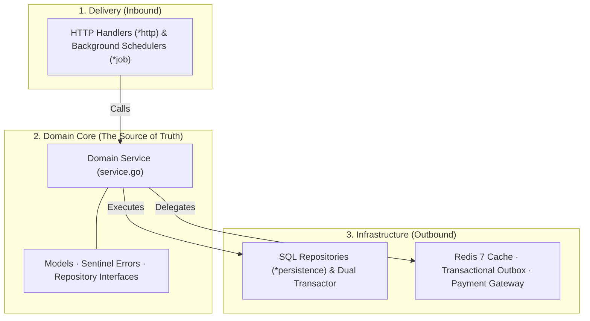
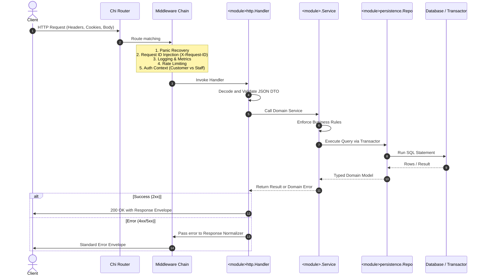
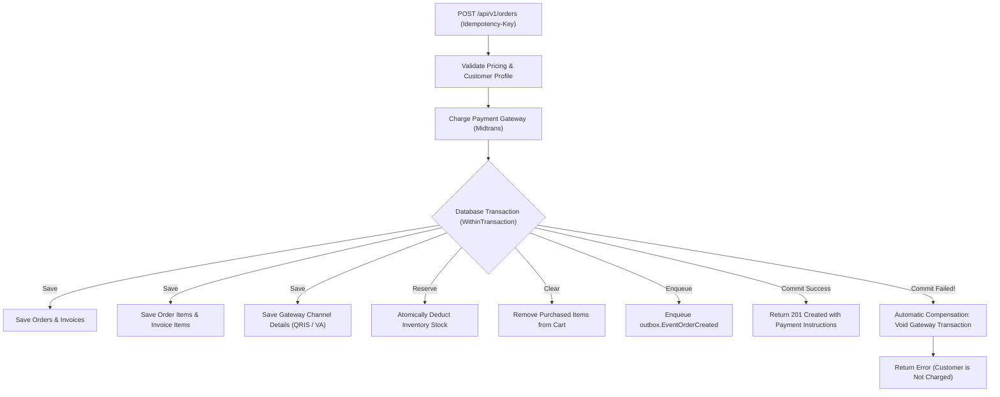
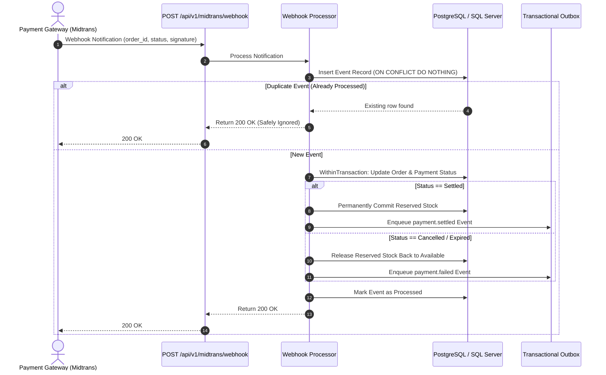
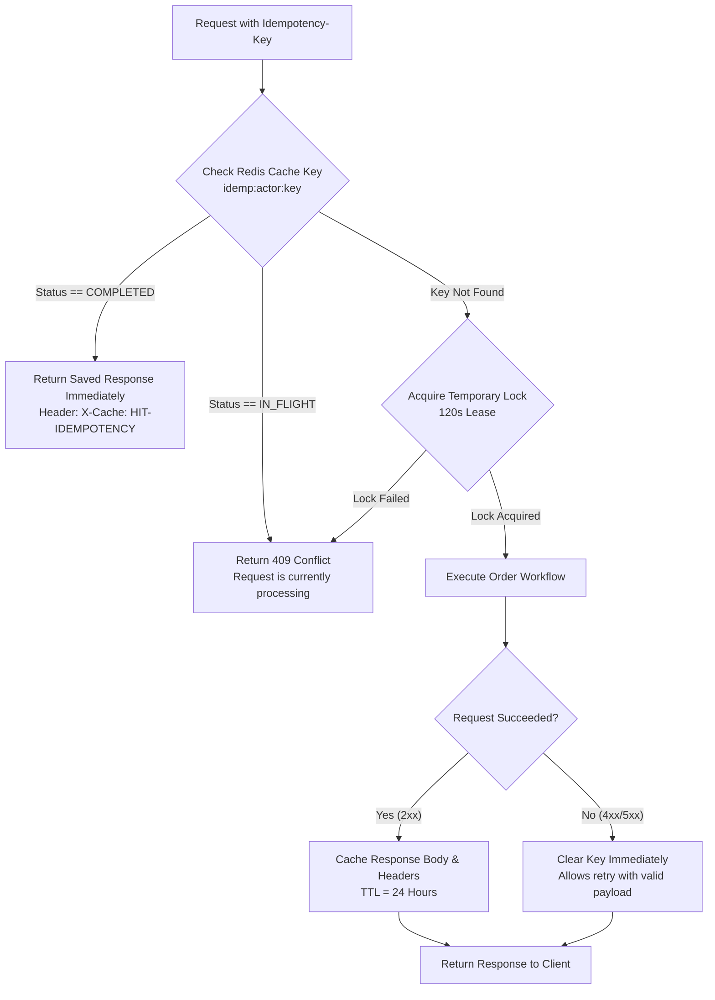
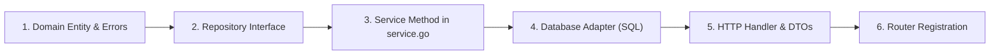

# Developer Architecture Tutorial

### Architectural Approach

When building a high-traffic e-commerce engine in Go, it is tempting to either over-engineer with deeply nested abstractions borrowed from class-based enterprise frameworks, or under-engineer into tangled monolithic handlers. KomeCore takes a pragmatic path shaped by idiomatic Go conventions: clear domain boundaries, inward-flowing dependencies, and zero magic.

Every piece of code has a deliberate place. Rather than dividing the application strictly by technical layers (e.g. putting all controllers in one directory and all models in another), KomeCore packages code by business domain. An order is an order, a cart is a cart. Within each domain, the domain root is the undisputed source of truth:

* **Package by Domain**: Business modules (`cart`, `order`, `product`, `payment`, etc.) live under `internal/modules/`.
* **Domain Root is the Source of Truth**: The root of each module (`package <module>`) owns the domain models, sentinel errors, repository interfaces, and the public application service (`service.go`).
* **Dependencies Flow Inward**: Delivery packages (`*http`) and database adapters (`*persistence`) import the domain root. The domain root never imports delivery handlers or database drivers.
* **Explicit Composition**: All wiring occurs in `internal/bootstrap/container.go` through standard Go struct initialization without reflection or global singletons.
* **Dual-Dialect Compatibility**: Database operations support PostgreSQL and Microsoft SQL Server through a unified transactor interface.



### Core Architectural Principles

These core principles guide every design decision across the codebase:

1. **Explicit Dependencies**: Constructors declare all required dependencies directly. There are no global singletons, hidden service locators, or package-level mutable state. If a service needs a database or clock, it declares it in its constructor.
2. **Deterministic Time**: Business logic uses `pkg/clock` (`clock.Now()`) rather than calling system time directly. This makes time-sensitive rules—such as flash sale cutoffs, voucher expirations, and token lifespans—completely deterministic and effortless to test.
3. **Exact Currency Arithmetic**: Financial calculations always use atomic integer amounts (`int64` minor units) via `pkg/money`. Floating-point arithmetic (`float32`/`float64`) is strictly forbidden to eliminate rounding errors during tax and discount calculations.
4. **Idempotency by Default**: Critical write operations are designed to safely absorb network retries and duplicate events without creating duplicate orders or double-charging customers.
5. **Fast Feedback**: Compiles in seconds, boots in milliseconds, and runs tests rapidly to maintain a frictionless developer experience.

---

### Directory Structure and Boundaries

To keep the codebase intuitive and easy to navigate, KomeCore organizes its files into clear physical boundaries:

```text
komecore/
├── cmd/komecore/         # App entry point
├── internal/
│   ├── apperror/         # Error types and codes
│   ├── authctx/          # Authenticated actor context
│   ├── bootstrap/        # Dependency wiring and lifecycle
│   ├── config/           # Environment configuration
│   ├── httpx/            # HTTP utilities and middleware
│   ├── infra/            # External infrastructure adapters
│   └── modules/          # Business domains
│       └── <module>/                       # Domain logic
│              ├── <module>http/            # HTTP handlers and DTOs
│              └── <module>persistence/     # Database operations
├── api/                  # API specs and collections
├── docs/                 # Architecture and guides
├── migrations/           # Database migrations
├── pkg/                  # Reusable utilities
└── test/                 # Architecture and integration tests
```

#### Boundary Rules

As a project grows, architecture decays when packages cross boundaries arbitrarily. KomeCore enforces four strict rules:

1. **Domain Root (`internal/modules/<module>`)**: Contains business rules and domain logic. It never imports database drivers, SQL packages, or HTTP libraries.
2. **Delivery Adapter (`*http`)**: Handles request decoding, input validation, calls domain services, and serializes JSON envelopes.
3. **Storage Adapter (`*persistence`)**: Implements repository interfaces using standard SQL queries, accepting a transaction executor so queries can run standalone or inside transactions.
4. **Utility Packages (`pkg/*`)**: Self-contained libraries (`clock`, `money`, `version`, `validator`) that do not import internal packages.

### Dual-Dialect Database Transactor

In an e-commerce platform, business transactions frequently span multiple tables—for example, deducting stock, recording an order, creating invoice items, and clearing a cart must succeed or fail together. However, coupling domain services to specific database drivers like `pgx` or `mssql` destroys testability and locks the application to a single vendor.

KomeCore solves this through a dual-dialect transactor pattern:

```go
// Repositories interact through the Executor interface:
type Executor interface {
    Exec(ctx context.Context, sql string, args ...any) (Result, error)
    Query(ctx context.Context, sql string, args ...any) (Rows, error)
    QueryRow(ctx context.Context, sql string, args ...any) Row
}

// Domain services define transaction boundaries:
type Transactor interface {
    WithinTransaction(ctx context.Context, fn func(Executor) error) error
}
```

This pattern keeps business logic clean and portable:
* **Services control boundaries**: The domain service decides *where* transactions begin and end (`s.transactor.WithinTransaction(...)`) without touching SQL drivers.
* **Repositories stay focused**: Repositories accept an `Executor` and focus purely on SQL query execution and row scanning. They can run either inside a transaction or standalone.
* **Effortless testing**: Unit tests can mock the `Executor` or use a dummy transactor, while integration tests verify real queries against PostgreSQL or SQL Server.

---

### Request Journey and Middleware Flow

To understand how the system functions in practice, follow a single HTTP request as it travels from the client, through the protective middleware shields, into the domain core, and back:



#### Pipeline Highlights

1. **The Middleware Shield**: When a request arrives, Chi passes it through pre-configured middleware chains:
   * **Panic Recovery**: Catches unhandled runtime panics, logs the stack trace, and returns a clean 500 error instead of terminating the server.
   * **Tracing & Logging**: Injects a unique `X-Request-ID` into the request context and response headers, allowing log correlation across distributed systems.
   * **Authentication Context**: Verifies JWT tokens and cookies, resolving the caller into a typed actor (`authctx.Actor`) with clear roles (`customer` or `staff`).
2. **HTTP Delivery Adapter**: The handler decodes the JSON payload into a strongly-typed request DTO and validates it with `pkg/validator`. If validation fails, it halts immediately and returns a formatted 400 Bad Request, shielding the domain layer from invalid input.
3. **Domain Service & Persistence**: The domain service coordinates the business operation, enforcing rules and calling the repository through the transactor. The repository executes SQL queries and maps the results back into domain models.
4. **Response Normalization & Error Handling**: Handlers return standard Go errors. A centralized response normalizer catches them and translates sentinel domain errors into appropriate HTTP status codes and consistent JSON envelopes, masking sensitive database details from external exposure.
5. **Lifecycle Management**:
   * **Bootstrapping**: `cmd/komecore/main.go` calls `bootstrap.New(cfg)`, initializing database connection pools, Redis cache, domain services, HTTP routes, and background schedulers in strict order.
   * **Graceful Shutdown**: On `SIGINT` or `SIGTERM`, the server stops accepting new connections, gives active HTTP requests up to 10 seconds to finish, halts background schedulers, and safely closes database pools.

---

### Core Distributed Lifecycles

In standard web applications, operations are simple and isolated. In an e-commerce platform, however, the system must coordinate multiple merchants, third-party payment gateways, asynchronous webhooks, and volatile inventory under heavy traffic. KomeCore handles these complex lifecycles with built-in resilience.

#### Multi-Shop Checkout and Payment Compensation

When a customer checks out with items from multiple merchant shops, KomeCore coordinates cart validation, dynamic shipping tariffs, voucher discounts, external payment charges, and inventory updates:



* **Parallel Pre-flight**: Customer profiles, delivery addresses, and shipping tariffs are verified concurrently before any payment is initiated.
* **Safety Compensation**: If the database transaction fails after a charge is created at the external payment gateway, KomeCore automatically calls `CancelTransaction` on the gateway, preventing orphaned payments and ensuring the customer is not wrongly charged.

#### Atomic Stock Reservation

During high-demand flash sales, hundreds of shoppers may attempt to buy the last few units at the same second. Reading the stock balance and updating it in separate steps leads to race conditions and overselling. Traditional heavy table locks slow down the database.

KomeCore solves this with atomic conditional updates:

* **Conditional Updates**: Stock deductions are performed with a single atomic SQL statement: `WHERE (stock - reserved_stock) >= quantity`.
* **Instant Rejection**: If available stock is insufficient, the query affects 0 rows, and the system immediately returns an out-of-stock error without reading stale data or waiting on locks.
* **Automatic Rollback**: If an order expires or is cancelled, the reserved stock is automatically returned to the available balance.

#### Webhook Payment Settlement

When a customer completes payment via QRIS, Virtual Account, or credit card, the payment gateway notifies KomeCore asynchronously via an HTTP webhook:



* **Idempotency Gate**: Payment gateways frequently retry webhooks. KomeCore logs every incoming webhook event with a unique key using `ON CONFLICT DO NOTHING`. If a webhook for the same order and status has already been handled, it is safely acknowledged with `200 OK` without re-running order logic.
* **Stock Finalization**: Once payment settles, reserved stock is permanently committed. If payment expires or is cancelled, the reserved stock is released back to the shop's available inventory.

#### Reliable Event Delivery (Outbox Engine)

When an order is created or paid, downstream actions must happen—such as sending confirmation emails, notifying merchant dashboards, or updating analytics. Publishing directly to external message brokers inside the HTTP request creates the dual-write problem: if the server restarts right after saving the order, the message is lost.

KomeCore uses the Transactional Outbox Pattern:

1. **Transactional Ingestion**: Domain events are saved to an `outbox_events` table inside the exact same database transaction as the business operation. If the transaction commits, the event is guaranteed to be persisted.
2. **Autonomous Background Worker**: A dedicated background scheduler polls for pending events every 5 seconds and dispatches them to their registered handlers.
3. **Exponential Backoff**: If a downstream service is temporarily unavailable, the worker retries with exponential backoff, keeping messages safely persisted in the database until delivered.

#### 24-Hour Distributed Idempotency

Network glitches and impatient shoppers often cause duplicate checkout submissions. KomeCore guards write endpoints with a distributed Redis idempotency mechanism requiring an `Idempotency-Key` header:



* **Short Lock (120s)**: Protects against simultaneous duplicate requests while ensuring the lock automatically releases if a server process hangs.
* **Long Cache (24h)**: Completed order responses are cached in Redis for 24 hours. Repeating the exact same request returns the original order confirmation with zero database hits.
* **Instant Error Clearing**: If input validation fails (e.g. an invalid voucher or missing address), the key is immediately evicted from Redis so the customer can correct the mistake and try again without delay.

---

### Feature Playbook: How to Add a Feature

When adding a new feature or endpoint to KomeCore, follow this structured 6-step recipe. To see how these pieces connect in practice, consider adding an item to a customer's wishlist:



#### 1. Domain Model (`internal/modules/<module>/`)
Model the business reality first. Define entity structs, state transition methods, and sentinel domain errors without importing any database or HTTP packages:
```go
// internal/modules/wishlist/wishlist.go
var ErrItemAlreadyInWishlist = errors.New("item is already in wishlist")

type WishlistItem struct {
    ID        string    `json:"id"`
    UserID    string    `json:"user_id"`
    ProductID string    `json:"product_id"`
    CreatedAt time.Time `json:"created_at"`
}
```

#### 2. Repository Contract (`internal/modules/<module>/repository.go`)
Declare data access contracts inside the domain package. Always accept `transactor.Executor` so operations can run either standalone or inside transactions:
```go
// internal/modules/wishlist/repository.go
type Repository interface {
    AddItem(ctx context.Context, tx transactor.Executor, item WishlistItem) error
    Exists(ctx context.Context, tx transactor.Executor, userID, productID string) (bool, error)
}
```

#### 3. Domain Service (`internal/modules/<module>/service.go`)
Implement the core business logic, rule validations, and workflow orchestration:
```go
// internal/modules/wishlist/service.go
func (s *Service) AddItem(ctx context.Context, userID, productID string) (WishlistItem, error) {
    exists, err := s.repo.Exists(ctx, nil, userID, productID)
    if err != nil {
        return WishlistItem{}, err
    }
    if exists {
        return WishlistItem{}, ErrItemAlreadyInWishlist
    }
    item := WishlistItem{ID: uuid.NewString(), UserID: userID, ProductID: productID, CreatedAt: s.clock.Now()}
    return item, s.repo.AddItem(ctx, nil, item)
}
```

#### 4. Database Queries (`internal/modules/<module>/<module>persistence/`)
Implement the repository interface using standard SQL queries, handling dialect parameter placeholders (`$1` for PostgreSQL, `@p1` for SQL Server) and row scanning:
```go
// internal/modules/wishlist/wishlistpersistence/repository.go
func (r *SQLRepository) AddItem(ctx context.Context, tx transactor.Executor, item wishlist.WishlistItem) error {
    exec := r.resolveExecutor(tx)
    query := `INSERT INTO wishlist_items (id, user_id, product_id, created_at) VALUES ($1, $2, $3, $4)`
    _, err := exec.Exec(ctx, query, item.ID, item.UserID, item.ProductID, item.CreatedAt)
    return err
}
```

#### 5. HTTP Delivery (`internal/modules/<module>/<module>http/`)
Define request/response DTOs, decode JSON input, validate parameters, invoke the domain service, and return standardized envelopes:
```go
// internal/modules/wishlist/wishlisthttp/handler.go
func (h *Handler) AddItem(w http.ResponseWriter, r *http.Request) {
    actor := authctx.MustGetActor(r.Context())
    var req AddItemRequest
    if err := httpx.DecodeJSON(r, &req); err != nil {
        httpx.WriteError(w, err)
        return
    }
    item, err := h.service.AddItem(r.Context(), actor.UserID, req.ProductID)
    if err != nil {
        httpx.WriteError(w, err)
        return
    }
    httpx.WriteJSON(w, http.StatusCreated, httpx.Envelope{"item": item})
}
```

#### 6. Container & Router Wiring (`internal/bootstrap/`)
Wire the repository and service into the DI container (`internal/bootstrap/container.go`), then register the route in `internal/bootstrap/router.go` using pre-built route chains:
```go
// internal/bootstrap/router.go
// The CustomerOnly chain automatically validates JWT auth and injects authctx.Actor:
r.RouteChains.CustomerOnly.Post("/api/v1/wishlist/items", wishlistHandler.AddItem)
```


---

### Testing Strategy

A clean architecture is only as dependable as the automated tests that protect it. KomeCore organizes verification across four balanced testing tiers:

1. **Unit Tests** (`internal/modules/*/*_test.go` · Instant: `< 10ms`)
   Focus on pure business logic and invariant validation using table-driven tests. Because domain services depend only on interfaces and accept mock transactors, complex business scenarios (such as discount calculations, price limits, and validation rules) run in milliseconds without spinning up a real database.

2. **Architecture Guardrails** (`test/arch/*_test.go` · Fast: `< 500ms`)
   Use Go's AST parser (`go/parser`) to inspect package imports across the entire repository. These tests guarantee that domain packages never import database drivers (`pgx`, `mssql`) or HTTP frameworks, ensuring architecture boundaries and package purity are enforced automatically by CI rather than manual code reviews.

3. **Contract Tests** (`test/contract/*_test.go` · Fast: `< 2s`)
   Verify that runtime HTTP handlers produce exact JSON responses that match OpenAPI 3.0 schemas and golden JSON snapshots. Every endpoint is checked for exact payload parity across OpenAPI, Postman, Bruno, and `.http` collections to prevent API drift.

4. **Integration Tests** (`test/integration/*_test.go` · Full: `~15s`)
   Spin up real, ephemeral PostgreSQL 17 and Redis 7 containers using `testcontainers-go` (`-tags=integration`). These tests verify atomic stock deductions under concurrency, multi-table transactor rollbacks, and 24-hour distributed idempotency locks against genuine database engines.
